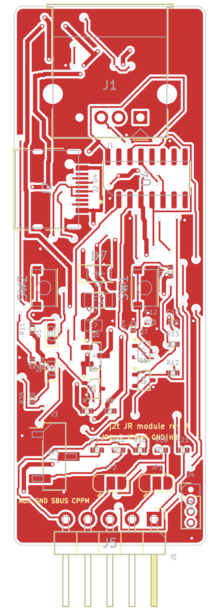
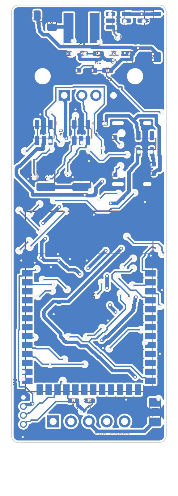

# JR bay module: prototype PCB

A 22 x 62 mm two-layer board that turns the firmware into a module for the external
module bay of an EdgeTX radio (TX16S and similar). It carries an ESP32-S3-WROOM-1, a USB-A
host port for the joystick, a USB-C console/flashing port, a 2S-to-5 V buck converter
and the bay connector. Everything in this directory was generated from one Python
description (`scripts/design.py`) with KiCad 7: schematic, PCB, routing, fabrication
outputs, BOM and the printable case.

**Status: designed, not built.** No board of this revision has been manufactured or
powered yet. Read "Before ordering" below.

Licence: the hardware design files in this directory are released under the
CERN Open Hardware Licence Version 2, Permissive (`LICENSE`, SPDX `CERN-OHL-P-2.0`).
The firmware keeps the project's licence.

 

## What is on the board

| Block | Parts | Notes |
|---|---|---|
| MCU | U3 ESP32-S3-WROOM-1-N8 | Same target as the firmware (`esp32s3` / `esp32s3-module` environments). Mounted on the radio side; its antenna area is unused and sits over copper (no Wi-Fi/BLE intended). |
| USB host | J1 USB-A receptacle, D2 ESD array, Q5/Q6 VBUS switch, F2 0.75 A polyfuse, C8/C9 2 x 47 uF | GPIO19/20 native USB. GPIO2 can switch the joystick's VBUS off (pulled up: on by default, no firmware support needed). |
| Console / flashing | J2 USB-C, U4 CH340C, Q7/Q8 auto-reset, SW1 RESET, SW2 BOOT | UART0 (TXD0/RXD0). Auto-reset works like on a dev board: `pio run -t upload` with no button presses. |
| Bay supply | F1 1.1 A polyfuse, Q1 reverse-polarity P-FET, U1 TPS54202 buck, L1 10 uH, C1/C2 input, C5/C7 output | 2S input (6.0 to 8.4 V) from the bay's VBAT pin to 5 V, up to about 1.5 A. Q1's gate rating limits the input to 2S packs. |
| Bench supply | D7 Schottky | USB-C 5 V is ORed into the 5 V rail: about 4.5 V on the rail when only the cable is plugged, enough for flashing and for the joystick on the bench. The buck has priority when the bay supply is present. |
| 3.3 V | U2 AP2112K-3.3 | 600 mA LDO from the 5 V rail. |
| Outputs | R16/R18 series resistors, JP1/JP2 solder jumpers, J5 bay header | SBUS on the bay's S.PORT pin, CPPM on the heartbeat pin, 1 k in series. |
| AUX | J3 1x3 header (GND, SBUS, CPPM) | For the radio's AUX serial port, or a cable to a 3.5 mm plug for the trainer jack. The on-board jack was dropped: a jack needs 10 mm of width plus locating pegs that would sit under the module. |
| Display | J4 1x4 1.27 mm pins (GND, 3V3, SCL, SDA), R26/R27 pull-ups | GPIO9 (SCL) and GPIO10 (SDA) for the I2C display described in `docs/hardware-options.md`. Not used by the firmware yet. |
| Sensing | R22/R23/C16 | Battery voltage on GPIO1 (ADC), 8.4 V -> 1.5 V. Not used by the firmware yet. |
| Indicators | D5 green status LED (GPIO38), D6 red 3.3 V LED | `led.gpio 38` is the default of the `esp32s3-module` environment. |
| Spare input | R21 | The bay's PPM pin into GPIO16 (future use). |

### Firmware pins

| Function | GPIO | Firmware key / build flag |
|---|---|---|
| SBUS out (bay S.PORT, AUX) | 17 | `sbus.gpio`, `-DJ2T_SBUS_GPIO` |
| CPPM out (bay heartbeat, AUX) | 18 | `cppm.gpio`, `-DJ2T_CPPM_GPIO` |
| Status LED | 38 | `led.gpio`, `-DJ2T_LED_GPIO=38` (set by `esp32s3-module`) |
| USB host D-/D+ | 19 / 20 | fixed |
| Console UART | TXD0 / RXD0 | fixed |
| Joystick VBUS enable (active high, pulled up) | 2 | not used yet |
| I2C SCL / SDA | 9 / 10 | not used yet |
| Battery sense (ADC) | 1 | not used yet |
| Bay PPM in | 16 | not used yet |
| BOOT button | 0 | strapping pin, as on a dev board |

Build the firmware for the module with `pio run -e esp32s3-module -t upload`.

### Bay connector and jumpers

The 5-pin header J5 follows the usual JR bay order as seen on the module:

| Pin | Signal | On the board |
|---|---|---|
| 1 | PPM | R21 -> GPIO16 (input, spare) |
| 2 | heartbeat | JP1: centre pad to GND (pad 1) or to the CPPM output (pad 3) |
| 3 | VBAT | fuse, reverse protection, buck |
| 4 | GND | JP2: centre pad to GND (pad 1) or to the CPPM output (pad 3) |
| 5 | S.PORT | R16 <- GPIO17 SBUS |

Both jumpers are open as shipped. **Measure the bay before bridging anything**: with the
radio on, the pin with battery voltage is VBAT and the one at 0 V next to it is GND. For
the standard order bridge JP2 1-2 (pin 4 = GND) and JP1 2-3 (pin 2 = CPPM). If the order is
mirrored on your radio, bridge JP1 1-2 and JP2 2-3 instead; S.PORT and PPM are both driven
through 1 k resistors, so a mirrored order is harmless and only needs `sbus.gpio` changed.
Do not bridge both jumpers to the same function.

## Files

| Path | Content |
|---|---|
| `kicad/j2t-module.kicad_pro`, `.kicad_sch`, `.kicad_pcb` | KiCad 7 project. The schematic embeds its symbols and the board embeds its footprints, so no extra libraries are needed. |
| `kicad/j2t-module.net` | Netlist exported from the schematic; `scripts/check_netlist.py` verifies it against `design.py` (44 nets, 0 mismatches). |
| `kicad/j2t-module-drc-report.txt` | DRC of the delivered board: 0 unconnected items, 0 clearance or courtyard errors; the remaining entries are "silkscreen clipped by board edge" warnings from the connector bodies and "footprint differs from library" notes (the WROOM courtyard was trimmed). |
| `fab/j2t-module-gerbers.zip` | Gerber X2 (F/B copper, paste, mask, silkscreen, fab, edge cuts) and Excellon drill files (PTH and NPTH separate, with maps). |
| `fab/j2t-module-pos.csv` | Pick and place, both sides, millimetres, KiCad conventions (Y grows upwards, origin at the sheet origin). |
| `fab/j2t-module-bom.csv` | BOM grouped by value and package with manufacturer part numbers where it matters. |
| `fab/*.pdf` | Schematic, component side and radio side (mirrored) drawings. |
| `case/case.scad`, `case/*.stl` | Parametric sleeve case, standard JR and lite variants (see "Case"). |
| `scripts/` | The generator: `design.py` (parts, nets, placement regions), `sch_gen.py`, `pcb_gen.py` + `router.py` (placement, routing, zones, DRC), `postprocess.py`, `bom.py`, `check_netlist.py`, `sexp.py`. |

## Board facts

- 22.0 x 62.0 mm, 1.6 mm FR-4, two copper layers, 1 oz, rounded corners (r 1 mm).
- Design rules used: 0.2 mm clearance, 0.2 mm signal / 0.5 mm power tracks (0.4 mm on the
  USB-C VBUS loop), vias 0.6 mm / 0.3 mm drill, 0.3 mm copper-to-edge, ground pours on
  both sides with solid pad connections. Any standard 2-layer service covers this
  (PCBWay standard: 2 layers, 1.6 mm, HASL or ENIG, green mask, white silk).
- Component side ("F", towards the pilot): USB-A at the top end, USB-C on the left edge,
  CH340C, buttons, LEDs, output resistors, jumpers, AUX header and I2C pins.
- Radio side ("B"): ESP32 module with its open (antenna) end towards the USB connectors,
  buck converter at the top end, ESD arrays and VBUS capacitors under the USB-A.
- Smallest parts: 0402 passives, SOT-323 transistors, 0.5 mm pitch USB-C pads. Meant for
  reflow (stencil files are in the Gerber set); hand soldering is possible with a fine tip
  and flux, except for the USB-C receptacle which wants hot air.
- 63 parts, 41 BOM lines. Manufacturer part numbers are given where a specific part is
  needed (regulators, FETs, ESD arrays, inductor, fuses, switches, connectors); the
  passives are generic 0402/0805/1210 X5R/X7R parts.

## Before ordering

Things that the design assumes and that a bench or a ruler should confirm first.

1. **Bay dimensions.** The width of 22 mm and the length of 62 mm were chosen from the
   published sizes of lite modules, not from a measured TX16S. Measure on the radio: cavity
   width, thickness (depth from the back face to the inner wall) and length, the position
   of the 5-pin socket relative to the cavity walls and its depth, and which way the
   module's back face points. Compare with the case parameters (`outer_w`, `outer_t`,
   `pcb_l + end_wall + lip`) and with the header position on the board (pins centred at
   x = 11 mm, 59 mm from the USB-A end, pointing out of the bottom edge).
2. **Header geometry.** J5 is a plain right-angle 2.54 mm header. The socket in the bay
   expects the pins at a certain height above the module's back face and a certain length;
   pick a header with long pins and check the height before soldering (the component side
   of the board faces the pilot).
3. **Bay pinout.** See the jumper section above. Nothing is connected to pins 2 and 4 until
   a jumper is bridged.
4. **Thickness.** USB-A receptacle (7.2 mm on the component side) + board + buck inductor
   (4 mm on the radio side) + walls gives about 17 mm. If the bay is thinner, use the 3 mm
   inductor noted in `design.py` (SWPA5030S, 1.5 A) and a low-profile USB-A, or let the
   USB-A end stick out of the bay (on the TX16S the top of the module is exposed).
5. **Routing style.** The board was routed by the script's own grid router (A*, rip-up and
   re-route, 0.1 mm grid). It is DRC clean but not pretty: expect long diagonal runs and
   USB D+/D- not routed as a length-matched pair (fine at full speed, 12 Mbit/s). A pass in
   KiCad to tidy the power loops (input capacitors C1/C2 to U1, L1 to C5/C7) is worth the
   time before a second revision.
6. **Power from USB-C while installed.** When the module sits in a radio that is switched
   off and the USB-C cable is plugged, the 5 V rail reaches the bay's VBAT pin through the
   buck's body diode and Q1 (about 4 V). Harmless for the radio's battery switch but flash
   on the bench, not in the radio, until this is verified.
7. **Current.** F1 holds 1.1 A at 2S input (the buck draws about 0.4 A at 7.4 V for a 1 A
   load on 5 V). F2 limits the joystick port to 0.75 A hold. C8/C9 provide 94 uF of ceramic
   bulk on VBUS, less than the 120 uF the USB specification asks from a host port; the
   SideWinder Force Feedback 2 powers its motors from its own supply and draws little from
   USB, so this is acceptable here.

## Ordering at PCBWay (or any fab)

1. Upload `fab/j2t-module-gerbers.zip`. Board 22 x 62 mm, 2 layers, 1.6 mm, 1 oz copper,
   minimum track/space 0.2 mm, minimum hole 0.3 mm, surface finish of your choice (ENIG
   is nicer for the 0.5 mm USB-C pads and the module pads).
2. For assembly, upload `fab/j2t-module-bom.csv` and `fab/j2t-module-pos.csv`. The position
   file uses KiCad conventions; PCBWay's importer accepts them, otherwise flip the Y sign.
   The 1.27 mm header J4 and the solder jumpers need no assembly; J1, J2 and J5 are
   through-hole or hybrid parts (hand soldering after SMT is fine).
3. Suggested substitutions: any ESP32-S3-WROOM-1 with 8 MB flash (N8, N8R2, N8R8); any
   40 V P-FET in SOT-23 with Vgs(th) around 1 V for Q1/Q5; 2N7002 (SOT-23) for Q6 and
   BC847 (SOT-23) for Q7/Q8 if SOT-323 parts are not stocked (footprints then need
   changing in `design.py`).

## Case

`case/case.scad` is a sleeve: the board slides in from the bay end and is held in slots in
the long walls; the bay end stays open (the header protrudes, the radio closes it), the
USB-A end is closed except for the receptacle. Openings for the USB-C (left side), the two
buttons, the two LEDs, the AUX header and the I2C pins are on the component side.

Two variants are rendered: `j2t-module-case-jr.stl` (outer 32.5 x 17.4 mm) and
`j2t-module-case-lite.stl` (outer 25.0 x 17.0 mm). The outer sizes are placeholders to be
replaced by the measured bay; both are set in the first lines of the file. Re-render with

```
openscad -o case_jr.stl   -D 'variant="std"'  case.scad
openscad -o case_lite.stl -D 'variant="lite"' case.scad
```

Print with the component-side face down (the large flat side), 0.2 mm layers, no supports
needed for the openings if they are bridged; PETG survives the radio's temperatures better
than PLA.

## Regenerating the design

Everything is derived from `scripts/design.py`. With KiCad 7 (its Python module `pcbnew`
must be importable), OpenSCAD and `kicad-cli` on the path:

```
cd hardware/scripts
python3 sch_gen.py out/j2t-module.kicad_sch                       # schematic
kicad-cli sch export netlist --format kicadsexpr -o out/netlist.net out/j2t-module.kicad_sch
python3 check_netlist.py out/netlist.net                           # must report 0 mismatches
python3 pcb_gen.py out/j2t-module.kicad_pcb --uuids out/j2t-module.kicad_sch.uuids.json   # place, route, fill, DRC
python3 postprocess.py out/j2t-module.kicad_pcb                   # drop dangling stubs, final DRC
python3 bom.py out/j2t-module-bom.csv
```

`pcb_gen.py` takes several minutes: it routes in up to four passes (failed nets first on the
next pass), stitches the ground pours with vias and routes whatever ground is still apart.
Placement is by named regions (`REGIONS` in `design.py`): parts are shelf-packed into their
region in list order, so moving a part means changing its `region` or the order of the
`add()` calls; the USB-C fan-out and the module's ground pin 40 are hand-prescribed paths
in `pcb_gen.py`.

## Design notes

- **Why a Schottky instead of an ideal-diode mux for the USB-C supply.** The first version
  had a P-FET mux with two level shifters; it did not fit next to the USB-C fan-out. The
  diode costs 0.4 to 0.5 V on the bench only, which the LDO and the joystick tolerate.
- **Why the module is mounted on the radio side, open end up.** The WROOM has pads on
  three sides; with the open side facing the USB connectors every pad row can escape
  towards the dense end of the board, and the pad rows face the board edges where the
  buttons, LEDs and output resistors sit on the other side.
- **Ground.** Both sides are ground pours with solid pad connections. Traces break the
  pours into islands; the generator stitches islands with vias and routes the leftovers,
  which is why there are a few short ground tracks.
- **ESD.** USBLC6-2SC6 arrays on both USB ports, placed with their middle pads towards the
  USB-A so that D+/D- and VBUS pass straight through them.
- **Not included.** Wi-Fi antenna clearance (the radio in the module is unused), a battery
  for the RTC, a second USB port for the console (the ESP32-S3's native USB is the host
  port), the 3.5 mm trainer jack (use the AUX header and a cable).
